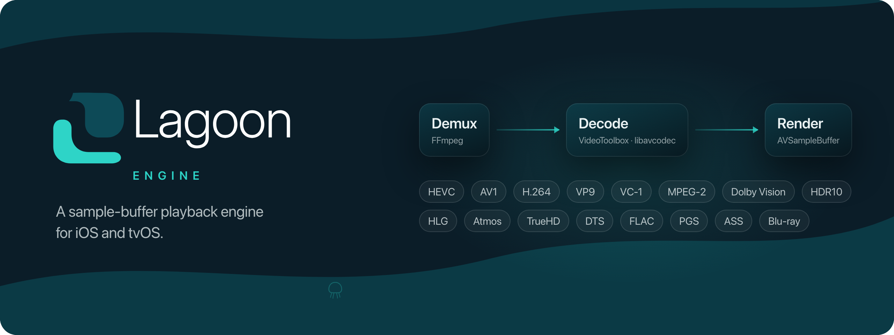

<p align="center">
  
</p>

<p align="center">
  
  
  
  <a href="https://github.com/helop-ou/lagoon-engine/releases"></a>
  <a href="LICENSE"></a>
  <a href="https://github.com/helop-ou/lagoon/blob/main/FAQ.md#was-ai-used-in-this-project"></a>
  <a href="https://github.com/helop-ou/lagoon-engine/actions/workflows/tests.yml"></a>
</p>

No `AVPlayer`, no third-party Swift dependency.

`AVPlayer` will not play much of what people have. This engine reads the
container with FFmpeg, decides per track whether the hardware takes the
bitstream, and feeds `AVSampleBufferDisplayLayer` and
`AVSampleBufferAudioRenderer` under an `AVSampleBufferRenderSynchronizer`.

It was extracted from [Lagoon](https://github.com/helop-ou/lagoon), a Jellyfin
client, and carries none of it: no server, no accounts, no UI. You hand it a
URL and track metadata, and you get a picture.

## What it plays

MKV, WebM, MP4, MOV, AVI, MPEG-TS and MPEG-PS containers, plus Blu-ray and DVD
disc images. HEVC, H.264, AV1, VP9, VC-1, WMV3, MPEG-2 and MPEG-4 Part 2,
including interlaced H.264 and MPEG-2 through the software decoder. HDR10, HLG
and Dolby Vision, including dual-layer profile 7 converted to 8.1 in flight.
Dolby Atmos passed through; TrueHD, DTS, FLAC and ALAC decoded to lossless
PCM. Embedded, PGS, VobSub, DVB and external subtitles, with styled ASS/SSA
drawn by libass in the fonts the file carries.

VideoToolbox decodes where the hardware takes the bitstream; libavcodec
decodes the rest.

The [codec table](docs/codec-support.md) has every codec and the path it takes.

## Requirements

iOS 26 and tvOS 26, Xcode 26.6. Apple silicon to build the native libraries.

## Adding it

```swift
.package(url: "https://github.com/helop-ou/lagoon-engine", from: "1.0.0")
```

```swift
.target(name: "YourApp", dependencies: [
    .product(name: "LagoonEngine", package: "lagoon-engine"),
])
```

The package carries its own FFmpeg build; there is nothing else to fetch or
configure.

## Using it

Make an engine, give it somewhere to draw, tell it what to open, and play.

```swift
import AVFoundation
import LagoonEngine

let engine = SampleBufferPlayerEngine()

// The engine draws into a layer you own and place in your view hierarchy.
let displayLayer = AVSampleBufferDisplayLayer()
engine.attach(displayLayer: displayLayer)

// Called once the first frame is on screen.
engine.onPlaybackStarted = { print("playing") }

// Called when the engine gives up. `cause` is either .undecodable — this
// device cannot decode these samples, only a re-encode would help — or
// .delivery, meaning the same media might play if fetched another way.
engine.onError = { failure in
    print(failure.cause, failure.message)
}

engine.prepare(
    url: url,
    startSeconds: 0,
    initialAudioOrdinal: nil   // nil lets the container decide
)
engine.play()
```

Buffering ahead, credentials, the `PlayerEngine` protocol and diagnostics are
in the [usage guide](docs/usage.md).

## Licence

[MPL-2.0](LICENSE). The Lagoon name is not part of that grant, and the native
libraries carry their own licences: [TRADEMARKS.md](TRADEMARKS.md) covers
both.

## Documentation

- [Documentation index](docs/README.md), then [coding
  standards](docs/standards.md) and [the engine guide](docs/engine.md).
- [Engineering notes](docs/reference/README.md): the mechanism and
  measurements behind the contracts.
- [Contributing](CONTRIBUTING.md): build and test commands, repository
  conventions.
- [Security reports](SECURITY.md) go privately by email, not into an issue.
- Taking part means keeping to the [Code of Conduct](CODE_OF_CONDUCT.md).
